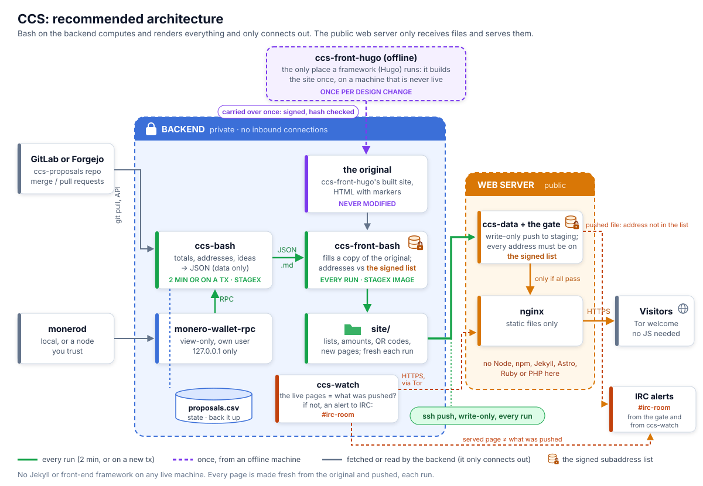

<p align="center">
  
</p>

# ccs-bash

[](https://github.com/plowsof/ccs-bash/actions/workflows/check.yml) [](https://github.com/plowsof/ccs-bash/actions/workflows/release.yml)

**A blazingly fast, memory-safe CCS backend. Written in shell.**

- **Blazingly fast:** a full run takes about 3 seconds, once every 2 minutes.
- **Memory safe:** it has no memory. Everything is recomputed on each run, except one CSV file
  (and two caches it can rebuild).
- **Fearless concurrency:** `flock -n`.
- **Zero-cost abstractions:** there are no abstractions.
- **A strong type system:** everything is a string, the money too. That's how the amounts stay exact.
- **A friendly compiler:** `shellcheck`.
- **Cargo:** `apt install jq`.

Not a crustacean. A mollusc.

A small replacement for [ccs-back](https://repo.getmonero.org/monero-project/ccs-back), the
backend of the Monero Community Crowdfunding System: a bash script, every 2 minutes and on each
donation, with a view-only `monero-wallet-rpc`. No web server, database or PHP. It writes the
JSON the site is made from (`proposals.json`, `completed-proposals.json`, and `projects.json` for
`/projects`).

## The project

Three repositories, and no framework, database or JavaScript on any live machine:

| Repository | What it is |
|---|---|
| **ccs-bash** (this one) | the backend: proposals, the wallet, totals, addresses, as JSON |
| [ccs-front-bash](https://github.com/plowsof/ccs-front-bash) | the site builder: fills the design with ccs-bash's data, every page, in bash |
| [ccs-front-hugo](https://github.com/plowsof/ccs-front-hugo) | the design: the site's HTML and CSS, built once with Hugo, released as a reproducible zip |

<p align="center"></p>

**Start here: [the handover](docs/handover.md)**, from ccs-back and Jekyll to this, step by step.
Why it's built this way: [the design](docs/design.md).

## Security

An attacker wants the donation addresses on the website. How the setup keeps them the wallet's
(no inbound connections, pinned images, a signed list checked on both machines, a web server
that only serves what its gate passed, and a watcher on it): [the design](docs/design.md). What
it can't fix: a shell on the web server can still change the site until ccs-watch alerts, which
is why visitors can check an address against the signed list themselves.

## What a run does

`ccs-back.sh`, top to bottom:

1. **Read proposals:** every `.md`'s front matter (`lib/frontmatter.awk`); a bad file is logged and
   skipped. Optional `tags:` (a list, e.g. `Abandoned`) go into the JSON, escaped.
2. **Check the wallet:** its main address is `WALLET_ADDRESS`, every subaddress in the state is
   its own (a restored wallet gets them made again); another wallet stops the run.
3. **Count donations** per subaddress (funded at `MIN_CONFIRMATIONS`, pending before), plus each
   proposal's donations to [retired wallets](docs/handover.md#retiring-a-wallet). Donations at a
   subaddress given to a proposal the state lacks stop the run; at one never handed out, they are
   logged and counted for no proposal.
4. **Record new proposals:** the merged MR that added each new file, and when funding started.
5. **Assign addresses:** a new subaddress for each `fr` proposal without one, after every index used.
6. **Fetch ideas:** open MRs (GitLab, or Forgejo pull requests: `REPOSITORY_URL`) adding exactly
   one new proposal file that reads as one, and only its images in `images/<its name>/`. The forge
   down: the previous list.
7. **Copy images** a proposal shows from its `images/<name>/` (PNG, JPEG or GIF, 2 MB at most) into
   the output, for ccs-front-bash; any other image stays a link.
8. **Write the JSON** (`lib/site.jq`), swapped in atomically.

| File | Does |
|---|---|
| `ccs-back.sh` | the steps above |
| `lib/common.sh` | logging, config, atomic writes, filename check |
| `lib/frontmatter.awk` | the proposal format parser, spec at the top |
| `lib/proposals.sh` | proposals to JSON, the state file |
| `lib/gitlab.sh` | ideas, merged MR lookup |
| `lib/wallet.sh` | wallet RPC, subaddresses, totals, QR codes |
| `lib/site.jq` | the JSON for ccs-front-bash and `/projects` |
| `notify-loop.sh` | optional: also run on new txes ([setup](docs/setup.md) step 5) |

## State

All is recomputed each run except `STATE_DIR/proposals.csv` (written by `jq -r '@csv'`):

```
filename,gitlab_url,subaddr_index,address,funding_required_date
"fund-me.md","https://repo.getmonero.org/.../merge_requests/697",43,"8...","2026-09-08T18:06:19Z"
```

It maps proposals to subaddresses and can't be recreated, so **back it up**: each new version
to another machine, which only adds copies ([setup](docs/setup.md#backing-up-the-state)). If it is
lost or wrong, runs stop rather than hand out new addresses ([troubleshooting](docs/troubleshooting.md)).

Two caches sit beside it, so a run doesn't redo work: `deposits.csv`, the wallet's deposits 30
blocks deep (each run then asks the wallet only for newer ones; a wallet that knows less stops the
run, so totals never go down), and `ideas.cache`, what each idea's merge request adds at a commit.
Deleted, either is made again on the next run. `deposits.csv` is backed up too, one copy that is
only replaced by one with every deposit it has. A wallet the CCS no longer uses is recorded in
`retired/<name>.csv`, state like `proposals.csv` ([retiring a wallet](docs/handover.md#retiring-a-wallet)).

## Two ways to run it

| | A) packages on the host | B) the pinned container |
|---|---|---|
| Tools from | Debian's packages | [StageX](https://stagex.tools): source-built, pinned, signatures checked ([details](docs/image.md)) |
| Host needs | the [dependencies](docs/setup.md#dependencies) | Docker with buildx, `git`; `gpg` and `jq` to build |
| Updates | `apt upgrade` | [change the pin](docs/image.md#changing-the-pin) and rebuild |

Same scripts, config and folders, so you can switch. B pins everything that runs; A avoids
Docker on the host and gets Debian's security updates automatically.

## Documentation

- [Handover](docs/handover.md): start here, from ccs-back and Jekyll to this, step by step; what you fill in
- [Recommended design](docs/design.md): bash renders the site on the backend, the web server only serves files
- [Setup](docs/setup.md): dependencies, installing step by step, backing up the state
- [Two machines](docs/two-machines.md): the backend pushes, the web server only receives; the gate, the alerts, the theme
- [The pinned image](docs/image.md): how B is built and checked, changing the pin, releases
- [Attesting a release](contrib/release/README.md): rebuild a release, sign what came out into ccs-sigs, as Feather Wallet does
- [When something is wrong](docs/troubleshooting.md): what the log lines mean
- [Reviewing](docs/reviewing.md): what each file that runs on the live machines does, and checks

## Tests

```
tests/run.sh             # end-to-end on tests/fixtures, fake wallet and GitLab
UPDATE=1 tests/run.sh    # rewrite tests/expected after an intended change
tests/rrsync.sh          # the two-machine setup, attacked from the wallet machine (docker)
shellcheck -x ccs-back.sh notify-loop.sh lib/*.sh tests/*.sh container/*.sh
```
