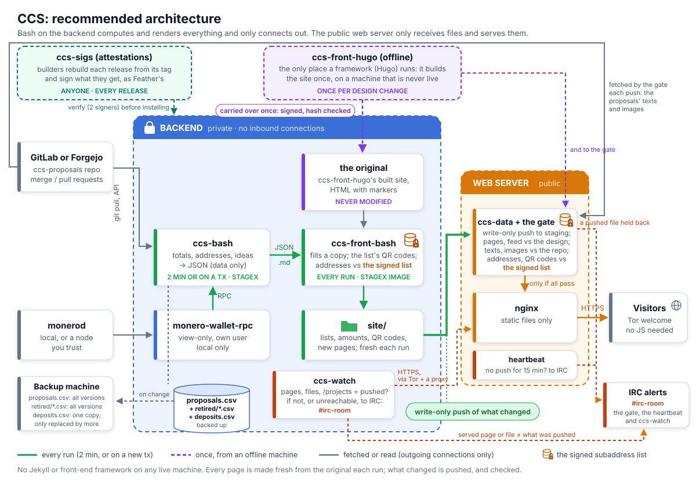

# Recommended design

**No front-end framework on any live machine, and the public web server trusts nothing it is
sent.** Bash, awk and jq on a backend that accepts no connections turn the wallet and the
proposals into a small data file, `site-data.json`: what only the backend knows (the totals, the
dates, each proposal's subaddress as an *index* into the signed list). That file is all it sends.
The web server checks it, builds the site from it itself with ccs-front-bash, the design and the
proposals repository it fetches, checks what it built, and serves it.



## Why not a live front end

| | A live Node front (the proposed new ccs-front) | This design |
|---|---|---|
| Code reachable from the internet | the app and its npm tree | Caddy serving files, from a pinned, attested image |
| Supply chain on live machines | npm (today's ccs-front: Ruby gems) | bash, awk, jq (no qrencode: the QR codes are made once, with the signed list) |
| Proposal Markdown rendered by | the framework, on the public server | a small awk renderer that escapes everything first, on the web server, from the repository it fetches |
| A compromised web server | can change any page until noticed | can too, but ccs-watch checks the live addresses and alerts IRC within minutes |

The donation addresses are what an attacker wants, and the web server shows them: keep it smallest
([the web server](web-server.md): everything on it, to review).

## The parts

**The design** (offline, never live): ccs-front-hugo, the only place a framework (Hugo) runs. It
builds the site once per design change, with markers where content goes: "the original",
carried to the web server as a release zip whose sha256 is checked there.

**Backend** (no inbound connections; out only to the forge, monerod, the web server, the backup
machine and the IRC bot; ccs-watch through Tor and a proxy; a mirror to the site it mirrors):

- **monero-wallet-rpc**, view-only, its own user, on 127.0.0.1 (in Docker: on a network only
  ccs-bash is on).
- **ccs-bash**: the state and `site-data.json`, every 2 minutes or on a new tx. It reads the
  network (the forge), so nothing it writes is trusted further on. A proposal's total counts the live wallet
  and every retired one (recorded in the state, each deposit counted once); no total can go down from one run to
  the next unless allowed by hand ([retiring a wallet](handover.md#retiring-a-wallet)).
- **ccs-watch**, after each push and between pushes at random times: fetches the live donation
  pages, ten other proposals' pages at random and `/projects`, as a visitor's browser would (one
  of three) and through Tor and a clearnet proxy, and alerts IRC if an address on them isn't the
  signed list's (nor allowed), or a donation box isn't its proposal's address, or its QR code the
  list's file. It catches what the gate can't: a taken-over web server that serves a foreign
  address to everyone, or to whoever it can't tell from the watcher; not one that tells them apart
  (curl's TLS handshake can give it away), which is why the Verify page asks visitors to check
  ([details](two-machines.md#watching-the-web-server-the-backend-raises-the-alarm)).
- **Backups** to another machine (not the web server), whose account can only add copies:
  `proposals.csv` (which proposal has which subaddress; nothing can make it again) and each
  retired wallet's record (only wallets its admin listed; a later version may only rename
  proposals), every version (`assigned.tsv`, the heights below which a subaddress's deposits
  came before it was handed out, isn't: lost, those few count again); `deposits.csv`, a cache, as
  one copy that only grows, so a restored
  wallet that knows less is caught ([setup](setup.md#the-backup-machine)). Root on the backup
  machine can still rewrite them all: restore the first retired version, and check a restored
  `proposals.csv` against the live site.
- **Pinned images:** ccs-bash runs in a [StageX](https://stagex.tools) image
  ([details](image.md)), read-only, no capabilities; in Docker, each step in its own container, as
  its own user ([docker](docker.md)). The wallet's image is
  getmonero.org's release binary on Debian, checked against its signed hashes, built on the
  backend and not attested (monero isn't in StageX).
- **Attested releases:** anyone can rebuild a release from its tag, byte for byte, and sign the
  result into [ccs-sigs](https://github.com/plowsof/ccs-sigs), as Feather Wallet does; a release is
  verified against those signatures before it is installed ([contrib/release](../contrib/release/README.md)).
- **The push:** `site-data.json` to the web server when it changed since what the gate last took
  (`contrib/ccs-push`: its sum against its record; once a day whatever), as a tar over ssh; an
  empty one otherwise, the heartbeat. Nothing else: no page, no stylesheet, no image.

**Web server:** Caddy (StageX's) serving `/var/lib/ccs-data` over HTTPS, its certificates its
own, and Tor (built from its signed source) serving it as an onion, both in the gate's image;
and a write-only push account whose key runs only the gate
(`contrib/ccs-receive`, its checks [ccs-check](ccs-check.md), one static Go binary): through the
host's sshd, or in Docker through the gate image's own sshd on its own port (StageX, attested
with ccs-bash's release). The push is `site-data.json` alone (any other file refuses it). The
gate checks it (each value of its kind; each proposal's subaddress an index the signed list has,
one proposal's only and the one the live site has for it; IRC told of one that fails) and
**builds the site itself** from it, with the ccs-front-bash release its image carries
(`vendor/ccs-front-bash`), the newest design release, the signed list and its QR codes, and the
proposals repository it fetches itself (each proposal's text, images and front matter, and its
merge request, read from the merge commit that added it). Then it checks what it built: every
address on every page, however split or disguised, the wallet's or allowed (the backstop for an
address in a proposal's own text), every donation QR code the signed list's file. A page that
fails is taken off the site and IRC is told; more than three at once, none of the new site goes
live ([details](two-machines.md#the-gate-the-web-server-builds-the-site-itself); what to review
there: [the web server](web-server.md)). Nothing else of the CCS runs there but the gate's
heartbeat (an alert when pushes stop).

ccs-front-bash runs on the web server alone: whatever writes the addresses into pages can
redirect donations, so it runs where it writes only the signed list's line of each index, never
an address the backend chose, and the backend has nothing more to send than the data.

## What one compromise can and can't do

The two machines watch each other, and each one's alarm reaches IRC without passing through the
other: the gate's goes from the web server to the bot, ccs-watch's from the backend. That holds
only with the bot on a third machine: a bot on the backend (the testnet's) lets the backend's root
drop the gate's alarms.

- **The web server taken over:** it can serve what it likes, but the backend's ccs-watch fetches
  the live pages and checks their addresses against the signed list and each proposal's own. It can tell the watcher from visitors
  only by guessing (Tor and a clearnet proxy, three browsers' ways of asking, random times),
  which is why the Verify page asks visitors to check too. It can't change the state, the
  addresses or the backups.
- **The backend taken over:** it can send only `site-data.json`, and the gate builds the pages
  itself from it once it passes: the design's pages, the proposals' text as their repository has
  it, and addresses from the signed list, made offline by a Core Team member, each proposal
  keeping the one it has. It can still give wrong
  totals and dates (numbers the gate can't check), or stop pushing: the web server's heartbeat
  says so. It can't send a donation anywhere but the CCS wallet.

What the watching doesn't cover is one flaw that opens both at once:

- **The admins' own ssh**, the same sshd open to the internet on every machine: a flaw before its
  key check opens them all. [Admin access](admin-access.md) puts it behind a VPN or an allowlist.
- **The same packages on both sides** (StageX's ssh, curl, OpenSSL in both images):
  reachable from outside only through what each machine exposes, but also by each machine from
  the other: the web server answers the backend's push (ssh, as a client; the tar is read in Go) and
  ccs-watch's fetches (curl). Each runs in a container of its own, as its own user, so a flaw
  there reaches that one stage, not the state or the wallet. But the watch's curl is the
  watching: a flaw in it can silence the watch itself, whose alarm is then only the Verify page's
  visitors. Keep the
  pins current (`container/update-images.sh`).
- **One release for both sides:** the gate is in ccs-bash's repository and release, beside the
  backend it checks. Attesters should read the gate's changes as their own diff, not as part of
  the backend's.
- **One forge:** both machines read the proposals from it, so a forge taken over feeds them the
  same text; the signed list still holds the addresses.

## ccs-front-bash

**The original** is the built design, with markers where content goes and "parts" (a card, the
donation box, a milestone…) whose `{{slots}}` are filled; all HTML comes from it. It is never
modified: each run starts again from it, so a bad run can't build on a bad one.

```html
<!-- ccs:list fr -->…<!-- /ccs:list fr -->
<!-- ccs:donate -->…<!-- /ccs:donate -->
```

jq renders each fragment (every value HTML-escaped, links https only) and awk swaps it in. A
missing, unmatched or repeated marker fails the build; the live site stays as it was. It runs on
the web server, from ccs-bash's copy of its release (`vendor/ccs-front-bash`, its tag and commit
checked in CI).

**Markdown:** a strict subset in awk. Everything is HTML-escaped first, so only tags the renderer
writes appear; raw HTML shows as text, links must be `https:`, images become links (nothing loads
from another site) except a proposal's own, in the repository's `images/<proposal>/`, which the
site serves from its copy. What the 268 proposals checked use:

| Used by | Feature |
|---|---|
| most | headings, paragraphs, lists, links, bare URLs, `*emphasis*` |
| tens | `**bold**`, numbered lists, `inline code` |
| a few | fenced code, `~~strike~~`, images (12), tables (5), quotes (5), reference links (5), footnotes (4) |
| 2 | raw HTML (shown as text) |

## The signed subaddress list

The wallet's subaddresses are listed once, in advance, and every address shown is checked
against it on both machines ([the signed list](signed-list.md): its files, and how it is made and
installed); visitors check the wallet itself:

| Where | Its job |
|---|---|
| the offline machine | made from a view-only wallet, with each address's QR code (qrencode), and signed by a Core Team member's own key (the one the Monero repository publishes); kept in ccs-bash's `subaddresses/<wallet>/` with `wallet.txt` (the wallet's address and view key), where others reproduce its sha256 and its QR codes' |
| web server, `/etc/ccs-gate/` (installed by hand, its QR codes too) | the gate builds each donation box from the list's line of the proposal's index (ccs-front-bash checks the list against its pin, and every address), and checks every address on every page, however written, and takes a donation QR code only as the list's file of the box's address (by its sum: it never makes or reads one): a taken-over backend can't get a wrong one live |
| backend, `/etc/ccs-front/` | ccs-watch checks every address the live site shows against it, each box against its proposal's, its QR code against the list's file |
| the Verify page | visitors check the address their wallet shows in a view-only copy of the CCS wallet, from its published address and view key: the defence left if the web server is taken over |

So a wrong address has to get past the backend, the web server, ccs-watch and anyone who looks
(each check, by function: [reviewing](reviewing.md#where-an-address-is-checked-against-the-signed-list)).
When the wallet nears index 15,000, a longer list is made and signed the same way; a new wallet
gets a list of its own, and the old one's addresses leave the site when it is retired.

## Setting it up

From ccs-back and Jekyll to this, step by step: [the handover](handover.md). The testnet CCS,
https://ccs.monerodevs.org, runs it ([testnet](testnet.md)).
