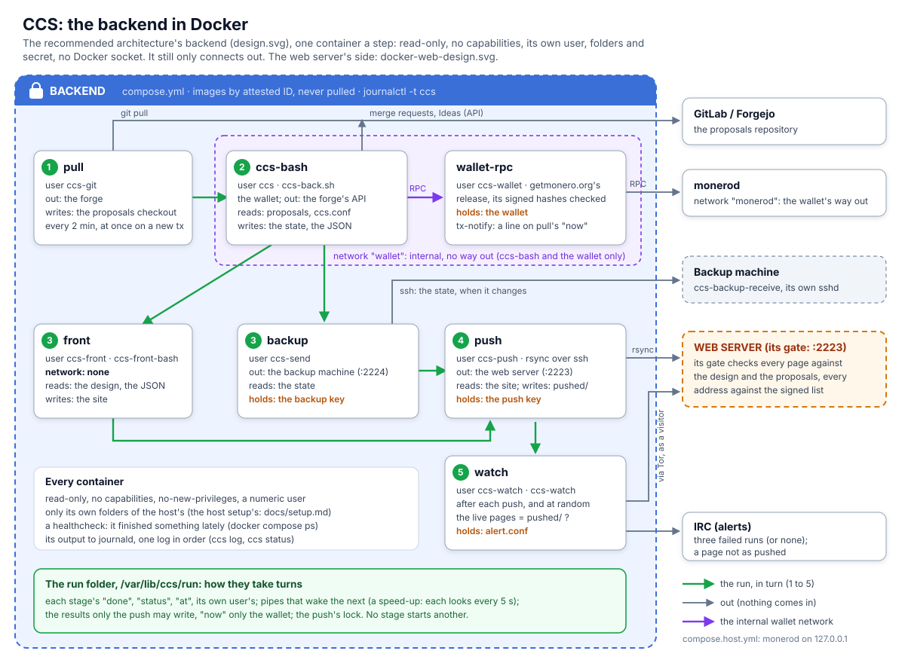
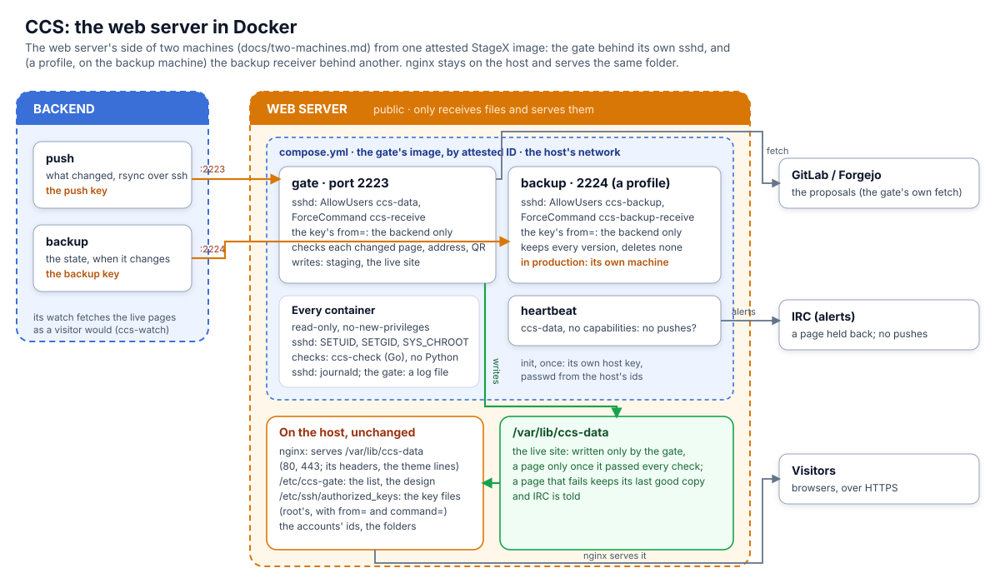

# The backend in Docker

<p align="center"></p>

[`contrib/docker/backend/compose.yml`](../contrib/docker/backend/compose.yml) runs the backend's
update ([the host setup's script](setup.md#the-update-script-the-host-setup)), and ccs-watch, as one service a stage,
and monero-wallet-rpc, instead of the host's loop ([setup](setup.md) steps 1 and 4-5). The host
keeps its folders and config (setup steps 2-3), so either one can run them, never both. The
testnet runs it ([the testnet](testnet.md)).

## The design

It is [the recommended architecture](design.md) unchanged: the backend makes the whole site and
only connects out; the web server's gate checks every page; ccs-watch checks the live ones; the
state goes to the backup machine. Docker only changes how each side runs: each step in a
container of its own, as a user of its own, so a fault in one (a hostile proposal file against
ccs-front-bash, a forge's answer against ccs-bash) reaches only that container's folders and
secret.

| Service | Its image | Its user | Its network | What it holds or may write |
|---|---|---|---|---|
| `wallet-rpc` | getmonero.org's release ([wallet-rpc/Dockerfile](../contrib/docker/backend/wallet-rpc/Dockerfile)) | `ccs-wallet` | `wallet` (internal), `monerod` (out) | **the wallet** |
| `pull` | ccs-bash's | `ccs-git` | out | the proposals checkout |
| `ccs-bash` | ccs-bash's | `ccs` | `wallet`, out | the state, the JSON |
| `backup` | ccs-bash's | `ccs-send` | out | **the backup key**; the sums of what it sent |
| `front` | ccs-front-bash's | `ccs-front` | **none** | the site |
| `push` | ccs-bash's | `ccs-push` | out | **the push key**; the copy of what was pushed; each run's result |
| `watch` | ccs-bash's | `ccs-watch` | out | **alert.conf**; its own counters |

- **Every one** read-only, no capabilities, `no-new-privileges`, a numeric user, only its folders.
  None has the Docker socket: no stage can start, stop or reach into another, and none can write
  another's files: ccs-bash can't change what was pushed, the sums of what was backed up, or the
  watch's counts of failed runs.
- **"Out"** is Docker's default network: out to anywhere, nothing in. There is no filter of
  where to: the push's key works only on the web server, the backup key only on the backup
  machine, and that is what keeps them to those.
- **The wallet's RPC** is on the `wallet` network only, which is internal: ccs-bash is the one
  other container on it, and neither reaches out through it (the wallet has its own way out to
  monerod; ccs-bash, to the forge). Its login stays in `wallet-rpc.conf`.
- **Why a container a stage, not one:** each secret is in the one container that needs it, and
  the one that reads untrusted input (front: proposal files) has no network and no secret. One
  container for the whole update would put the wallet's RPC, the push key and the backup key
  beside ccs-front-bash. The price is the run folder, below.
- **How they take turns** ([`step`](../contrib/docker/backend/step)): the run folder
  (`/var/lib/ccs/run`) has each stage's folder, its own user's: `done` (the last run it finished),
  `status`, `at`; pipes that wake the next; and the push's lock, which the watch shares. A wake
  pipe only makes it quicker (a waiting stage looks at the others' `done` every 5 seconds anyway),
  so any stage may write one. The two that mean something are their writer's alone: each run's
  result (`push/watch`) only the push writes and the watch reads; a line on `pull/now` starts a run
  at once, and only the wallet (a new transaction) and root (`ccs proposal:process`) may write it.
  **The pace**, as the host setup's `notify-loop.sh` has it: a run every 2 minutes; sooner on a
  new transaction (lines that come during a run: one run after it, however many); 30 seconds
  after a run that left a donation pending, so its confirmation shows a run later; and never two
  starts closer than 30 seconds (`CCS_MIN_GAP`), so a stream of transactions can't make the runs
  follow each other faster than that.
- **The images** by ID, never pulled: ccs-bash's and ccs-front-bash's as
  [their releases](handover.md#the-releases) attest them (the same checks:
  [upgrading](handover.md#upgrading)). ccs-bash's carries git and its https transport, ssh and
  rsync (StageX, signatures checked as its other packages), and of those packages nothing else
  ([`container/Dockerfile`](../container/Dockerfile), checked by `tests/image.sh`). Two things run
  that no attestation covers: the front's stage runner, `step`, mounted from ccs-bash's checkout
  (check it out at the attested commit: [upgrading](handover.md#upgrading)); and the wallet's
  image, built here, not StageX's (monero isn't packaged there; its release is built for glibc)
  and not attested: its archive is checked against getmonero.org's signed hashes (kept in the
  repository), the signature against binaryFate's key by fingerprint.
- **Building** is on the backend (`container/build.sh`), or anywhere, then copied: `docker save
  <ID> | ssh <backend> docker load` keeps the ID, which is what's checked
  ([setup](setup.md), step 3).
- **The log:** every container's output to journald under one name, `ccs`: a run's lines in
  order, whichever stage said them, rotated by journald (`journalctl -t ccs`). `ccs log` and
  `ccs status` read it.
- **The watch's check** holds the push's lock only while it copies what was pushed (6.5 MB on
  the testnet, a moment), then compares the copy: a push never waits for its minute of fetches.
- **Health:** each stage's healthcheck is that it finished a run lately (the watch: a check);
  `docker compose ps` shows it. A failed run still counts as finished: ccs-watch alerts on three.
  And no result at all for 5 minutes (a stage stopped or stuck, so no push and no result) counts
  as a failed run, again every 5 minutes: three alert, as failing runs do.

## A host whose monerod is on its own 127.0.0.1

The wallet on the `wallet` network reaches monerod (`daemon-address` in `wallet-rpc.conf`) over
its `monerod` network: another machine, or this one on an address containers reach. A monerod
(or alert.conf's proxy and bot) listening on the host's 127.0.0.1 only, as on the testnet, isn't
one of those: [`compose.host.yml`](../contrib/docker/backend/compose.host.yml) puts the wallet,
ccs-bash and the watch on the host's network instead, the wallet's RPC on 127.0.0.1, as the host
setup has them; the other stages keep theirs. In `.env`: `COMPOSE_FILE=compose.yml:compose.host.yml`;
in `ccs.conf`, `RPC_URL=http://127.0.0.1:18082/json_rpc` (without it, `http://wallet-rpc:18082/json_rpc`).
Its price: any process on the host can reach the wallet's RPC on 127.0.0.1 (its login still
needed), as in the host setup.

## Setting it up

On the backend, as root, after [setup](setup.md) steps 1-2's users, folders and config (step 1's
wallet files and `wallet-rpc.conf`, not its service). The config files, filled in as far as
they are public: [contrib/examples/backend](../contrib/examples/backend/README.md), which also
says how to install them; `ccs config:check` then says what is missing or wrong.

1. **The images.** ccs-bash's and ccs-front-bash's: their attested IDs, built here
   (`container/build.sh`, as for the host setup) or loaded. The wallet's:
   `docker build -q contrib/docker/backend/wallet-rpc` (its ID: the output).
2. **The compose's own users, and their folders:**
   ```
   for u in ccs-push ccs-send ccs-watch; do useradd --system --no-create-home --shell /usr/sbin/nologin $u; done
   install -d -o ccs-push -m 700 /etc/ccs/push             # the push key and the web server's host key
   install -d -o ccs-send -m 700 /etc/ccs/backup           # the backup key and the backup machine's
   install -d -o ccs-push -m 755 /var/lib/ccs/pushed       # what was pushed
   install -d -o ccs-watch -m 755 /var/lib/ccs/watch       # ccs-watch's counters
   install -d -o ccs-front -m 755 /var/lib/ccs/www         # the site
   install -o ccs-git -m 644 /dev/null /var/lib/ccs/pull-ok
   chgrp ccs-watch /etc/ccs/alert.conf                     # root:ccs-watch 640
   ```
   The keys: `id_ed25519` and `known_hosts` in each of `/etc/ccs/push` and `/etc/ccs/backup`,
   600, owned by the folder's user ([two machines](two-machines.md), [the web server in
   Docker](#the-web-server-in-docker) for the host keys' lines).
3. **`ccs.conf`'s `RPC_URL`:** `http://wallet-rpc:18082/json_rpc` (or 127.0.0.1, above).
4. **`.env`** beside `compose.yml` (root's, 600), from the examples (or
   [`env.example`](../contrib/docker/backend/env.example)): the three image IDs, the users'
   `uid:gid` (`id -u ccs`, `id -g ccs`...), the push and backup accounts and their ports, the
   site's address; `WALLET_PORT` if `rpc-bind-port` isn't 18082.
5. **The run folder:** `install -d -m 755 /var/lib/ccs/run`, then
   `docker compose --profile init run --rm -T init`.
6. `docker compose up -d`, then `ccs config:check` until nothing fails (it asks the wallet
   through ccs-bash's container, so after the start); `ccs status` names the services, their
   health and each stage's last run.

**From the host setup:** between runs, `systemctl disable --now ccs-bash ccs-wallet-rpc
ccs-watch.timer`; step 2 (move the push key from `/var/lib/ccs/.ssh`, and `/var/lib/ccs/state/watch`
to `/var/lib/ccs/watch`); copy the backup's sums (`/var/lib/ccs/backup-sent*` to
`/var/lib/ccs/run/backup/sent-<file>`, `ccs-send`'s, so nothing is sent again); then step 6.
**Back:** `docker compose down`, `systemctl enable --now ccs-wallet-rpc ccs-bash ccs-watch.timer`
(the push key and the watch's state back where the host setup has them).

**From a compose before its own users** (v0.2.30's, or a build before them: push, backup and
watch as `ccs`): between runs, step 2 (moving the push key from `/var/lib/ccs/.ssh`, the
watch's state from `/var/lib/ccs/state/watch`, `chown -R ccs-send /etc/ccs/backup
/var/lib/ccs/run/backup` and `chown -R ccs-push /var/lib/ccs/run/push`); `.env`'s new
`PUSH_UID`, `SEND_UID`, `WATCH_UID` (and from v0.2.30's: `CCS_SITE_URL`, `COMPOSE_FILE`, `LOG_GID`
out, `systemctl disable --now ccs-watch-after-push ccs-watch.timer`); step 5's `init` again (the
users' folders, the pipes' groups); `docker compose up -d`. A wallet RPC port of 18182 (the
testnet's): `WALLET_PORT=18182`, the default is 18082 now.

## Running it

`ccs` works as before ([looking](troubleshooting.md#looking)): `ccs proposal:process` starts a
run at once and prints it; `ccs status`, `ccs log` read the journal. `journalctl -t ccs -f`
follows every stage; `docker compose logs -f <service>` one. A stage that fails says so in its
`status`, and the run's result goes to the watch (three failed runs alert).

- **Upgrading:** step by step in [the handover](handover.md#deploying-a-set-the-docker-setup): the
  new attested IDs in `.env`, between runs (`ccs status`: no run going), `docker compose up -d`. A new monero: its `hashes.txt` (signed) and the version and sum in
  `wallet-rpc/Dockerfile`, then build it.
- **Pausing** (to edit the state by hand, [troubleshooting](troubleshooting.md#doing-things-by-hand)):
  `docker compose stop pull`, then wait for `ccs status` to show no run going; after, `docker
  compose start pull`. The other stages wait for the pull, so nothing else runs meanwhile. (No
  results come either: past 5 minutes the watch counts the pause as failed runs, so three
  alert at 15. Longer: say so on IRC first.)
- **Retiring a wallet** ([the handover](handover.md#retiring-a-wallet)): `retire-wallet` runs on
  the host and asks the wallet's RPC, so with `compose.host.yml` it works as in the host setup;
  with the wallet on its internal network, run it from the host setup for the switch (paused as
  above) until the compose has a way.
- **A design upgrade** needs nothing more: `front` mounts `/opt/ccs-front-hugo`, so a renamed
  `public` is seen. Likewise the site: `push` mounts `/var/lib/ccs/www`, not `www/site`, which
  ccs-front-bash replaces each run (a mount of a folder keeps the one it was given).
- **The proposals checkout replaced** ([another forge](setup.md#proposals-on-another-forge)):
  `docker compose up -d --force-recreate pull ccs-bash front` after, for the same reason.

## The web server in Docker

<p align="center"></p>

[`contrib/docker/web/compose.yml`](../contrib/docker/web/compose.yml) runs the web server's side
of [two machines](two-machines.md), the gate and its heartbeat, and the backup machine's, the
backup receiver, from one image, the gate's ([`container/gate.Dockerfile`](../container/gate.Dockerfile)),
instead of the host's sshd and `/usr/local/bin` scripts. **nginx stays on the host**, serving
`/var/lib/ccs-data` as before: the gate writes the same folder, so nginx's config doesn't
change. The host keeps the accounts' ids, folders, key files and `/etc/ccs-gate`
(two-machines' setup), so either one can run them, never both on the same port.

| Service | Its machine | Its user | Port | Its capabilities | What it may write |
|---|---|---|---|---|---|
| `gate` | the web server | sshd as root; the forced command as `ccs-data` | 2223 | `SETUID`, `SETGID`, `SYS_CHROOT` | staging, the live site, the gate's state, its log |
| `heartbeat` | the web server | `ccs-data` | none | none | the gate's state, its log |
| `backup` (profile `backup`) | **the backup machine** | sshd as root; the forced command as `ccs-backup` | 2224 | the same as the gate's | the backups |

- **The backup receiver on its own machine:** the web server's root could rewrite every copy of
  `proposals.csv` if the backups were there ([the design](design.md)), so `backup` runs only with
  its profile, on the backup machine: there, `docker compose --profile backup up -d backup`. A
  test setup may put both on one machine (`COMPOSE_PROFILES=backup`), as the testnet does.
- **The image:** StageX by digest (signatures checked), sources by sha256, built as ccs-bash's,
  reproducible, attested in the same release (`contrib/release/build ccs-bash vX` builds both; its
  second line is `ccs-gate-vX`; `contrib/release/verify ccs-gate-vX`). GNU userland, as the gate
  was written and tested for; sshd (no ssh client, sftp or agent); Python; git; and the QR reader's
  libraries: libzbar built here (StageX publishes none; with zbar's own fix of a crash under
  clang), on pixels libpng, libturbojpeg or giflib decode; qrencode built with PNG output, as
  ccs-front-bash builds it, so its QR codes are the backend's, pixel for pixel. About 165 MB.
- **sshd** as root, read-only, every capability dropped but the three it can't log anyone in
  without (`compose.yml` says why each), `no-new-privileges`, memory- and process-limited. One
  sshd a service, one user each (`AllowUsers`), its forced command (`ForceCommand`, and the key
  file's `command=`); keys only, in the host's root-owned key files (`/etc/ssh/authorized_keys`,
  with their `from=`); no shell, terminal, forwarding, agent, tunnel, environment or subsystem
  ([`sshd_config`](../contrib/docker/web/sshd_config)). On the host's network, so `from=` sees the
  backend's own address (Docker's published ports would show it Docker's for IPv6).
- **Its host key** is its own (`/etc/ccs-gate/ssh`, made by `init` the first time), not the
  host's: the backend's `known_hosts` gets a line for `[<web server>]:2223` (and for
  `[<backup machine>]:2224`, from that machine's own `init`).
- **The log:** sshd's lines to journald (`journalctl -t ccs-web`); the gate's own to
  `/var/log/ccs-web/ccs-gate.log` (a folder mounted: a rotated file would stay the old one; the
  image has no syslog socket for `logger`).
- **Tests:** `tests/gate.sh` with `GATE_IMAGE` runs every check of the gate with this image as the
  web server; `tests/gate-image.sh`, inside it, its QR reader and tools; `tests/web.sh` attacks
  its sshd, run as `compose.yml` runs it, from the backend's keys and from another machine.

### Setting it up

On the web server (and the backup machine, for `backup`), as root, after two-machines' setup of
the accounts, folders, key files and `/etc/ccs-gate` (the host's sshd lines for them can stay
until the switch):

1. **The image:** its attested ID (`contrib/release/verify ccs-gate-vX`), built here
   (`container/build.sh ccs-gate gate.Dockerfile`) or loaded (`docker save <ID> | ssh <web
   server> docker load`).
2. **Folders:** `install -d -m 700 /etc/ccs-gate/ssh`; `install -d -o ccs-data -m 755
   /var/log/ccs-web`.
3. **`.env`** beside `compose.yml` (root's, 600), from
   [`env.example`](../contrib/docker/web/env.example): the image ID, `id -u ccs-data`:`id -g
   ccs-data` and the same for `ccs-backup`.
4. `docker compose --profile init run --rm -T init`: it prints the host key.
5. **The firewall:** 2223 (the backup machine: 2224) open to the backend's addresses only (`ufw
   allow from <backend> to any port 2223 proto tcp`, IPv6 too if `from=` has it, and a cloud
   provider's list).
6. `docker compose up -d` (the backup machine: `docker compose --profile backup up -d backup`);
   `docker compose ps` shows them healthy.
7. **The backend:** `[<web server>]:2223 <key>` in `/etc/ccs/push/known_hosts`, `[<backup
   machine>]:2224 <key>` in `/etc/ccs/backup/known_hosts` (the host names as `.env`'s `CCS_PUSH`
   and `CCS_BACKUP` have them), then in the backend compose's `.env` `CCS_PUSH_PORT=2223` and
   `CCS_BACKUP_PORT=2224`, `docker compose up -d` between runs (the host loop: `-p 2223` in its
   push's `ssh`, `-p 2224` in its backup's). The next run pushes through the container: its line
   in `/var/log/ccs-web/ccs-gate.log`, ccs-watch's check after it.
8. **Then** the host's: `systemctl disable --now ccs-heartbeat.timer`; the `Match User ccs-data`
   (and `ccs-backup`) blocks out of `/etc/ssh/sshd_config` (`sshd -t`, `systemctl reload ssh`), so
   port 22 no longer takes those keys. **Back:** the blocks and the timer again, the backend's
   ports back to 22, `docker compose down`.

**Upgrading:** the new attested ID in `.env`, `docker compose --profile init run --rm -T init`
(passwd and group again; the host key stays), `docker compose up -d`; step by step, with a new
design: [the handover](handover.md#deploying-a-set-the-docker-setup).
