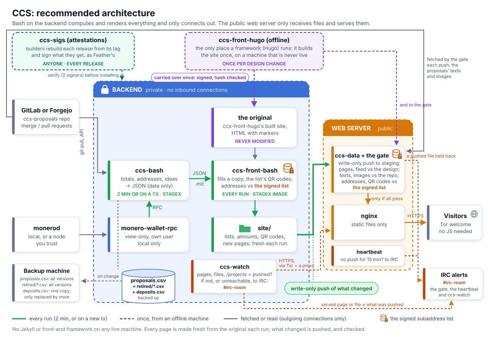

# Handover: running the CCS on ccs-bash

For the maintainer of ccs.getmonero.org (today: ccs-back, PHP and MySQL, and the Jekyll
ccs-front). The steps build the setup below box by box; then the old site is switched off.

<p align="center"></p>

**Stays:** the proposals repository, the CCS wallet and every proposal's subaddress, the site's
address and `/projects`. **Goes:** PHP, MySQL, Jekyll, Ruby; the web server runs no code. Why:
[the design](design.md).

**The setup is Docker** on each machine: the backend compose and the web server compose
([docker](docker.md)), each stage its own container, user and secret, every image pinned by its
attested ID. That is the only setup these docs describe; the hosts keep only the accounts,
folders, config and keys ([setup](setup.md)).

**Only looking after it?** `ccs` on the backend does what ccs-back's artisan commands did, by
the same names (`ccs proposal:process`, `ccs wallet:notify`...), and `ccs status`, `ccs log`:
[troubleshooting, Looking](troubleshooting.md#looking). **Setting it up:** the files to fill
in, filled in already as far as they are public, are in
[contrib/examples/backend](../contrib/examples/backend/README.md); `ccs config:check` says what is
still missing or wrong ([what you fill in](#what-you-fill-in)).

## Before you start

- **Machines:** the **backend** (private, no inbound connections), the **web server** (public),
  a **backup machine** (any but the web server), and an **offline machine** for the signed list.
- **The wallet**, view-only. Its address and view key are public: luigi1111 published them in
  [monero-project/meta #935](https://github.com/monero-project/meta/issues/935#issuecomment-1867257410).
- **A Core Team member** to make and sign the subaddress list (step 4), and **an IRC bot** (step 8).
- **How you yourselves get in:** each machine's admin ssh behind a VPN or an allowlist, and a
  way back in without ssh: [admin access](admin-access.md).

## The releases

The three repositories release separately; this set works together and runs the testnet. Each
new set replaces the row (earlier sets: this file's history, and ccs-sigs).

| Set | ccs-bash | ccs-front-bash | ccs-front-hugo | Running on |
|---|---|---|---|---|
| 2026-11-04 | v0.2.50 | v0.1.27 | v0.1.29 | [ccs.monerodevs.org](https://ccs.monerodevs.org), in mirror mode, with its onion and its feed: the backend compose and the web server compose (its gate default-deny in Go, its image busybox's), the site served by its `www` (Caddy) and `tor`, each machine verifying with its own `trusted-signers` (throwaway-50, ccs-sigs #53) |

Each is reproducible, and attested in [ccs-sigs](https://github.com/plowsof/ccs-sigs) by those who
rebuilt it: on the testnet so far by one throwaway key a set (one person; the CCS's should be two
or more people). Install only what `contrib/release/verify` confirms ([upgrading](#upgrading)),
and keep `trusted-signers` to the people you trust now (an old key whose secret wasn't really
destroyed could attest anything).

## 1. monerod and monero-wallet-rpc (the backend)

monerod (local, or one you trust) and monero-wallet-rpc with the CCS wallet, view-only: the
compose's `wallet-rpc`, on a network only ccs-bash is on ([docker](docker.md)).

**monerod.** On the backend itself, or another machine you run: the wallet asks it for every
block, so it must be one you trust (a node that lies can hide donations, not invent spendable
ones). The compose expects it at `daemon-address` in `wallet-rpc.conf`, reached from the
wallet's container over its `monerod` network, which goes out like any container's. So monerod
must listen where a container can reach it, **not on 127.0.0.1 only**: inside a container,
127.0.0.1 is the container itself.

- **Its restricted RPC for the wallet** (`--rpc-restricted-bind-ip`, `--rpc-restricted-bind-port
  18089`): a view-only wallet syncs from it as from any public node, and it can't stop, ban or
  reconfigure monerod. Keep the unrestricted RPC on 127.0.0.1, for you.
- **On the backend itself:** the containers reach the host as `host.docker.internal` (the
  compose maps it to the host's bridge address, `host-gateway`), so
  `daemon-address=host.docker.internal:18089`, with monerod's restricted RPC on `0.0.0.0` (or the
  bridge's address, `172.17.0.1`, when 18089 shouldn't be public). ufw's default denies the
  containers too: `ufw allow from 172.16.0.0/12 to any port 18089 proto tcp`.
- **On another machine:** `daemon-address=<it>:18089`, its firewall open to the backend.
- A firewall's rate limits on 18089 (a public node's flood rules) count the wallet's container
  as any client: a few connections a sync, well under them, but a flood that trips a global
  limit slows the wallet too.

`ccs config:check` says when `daemon-address` is one the wallet's container can't reach. The same
goes for ccs-watch's proxies (`WATCH_PROXY`, [the alerts](#8-the-alerts)): Tor on the backend
listens on the bridge's address, for the compose's networks only, and starts after Docker (the
address exists once Docker does):

```
# /etc/tor/torrc
SocksPort 127.0.0.1:9050
SocksPort 172.17.0.1:9050
SocksPolicy accept 127.0.0.0/8
SocksPolicy accept 172.16.0.0/12
SocksPolicy reject *
# systemctl edit tor@default: [Unit] After=docker.service; then systemctl reload tor@default
ufw allow from 172.16.0.0/12 to any port 9050 proto tcp
```

and `WATCH_PROXY=socks5h://host.docker.internal:9050` (an `ssh -D` clearnet proxy the same way:
`-D 172.17.0.1:1080`; a `SocksPolicy` covers every `SocksPort`, hence 127.0.0.1 accepted too).
The bot is on a third machine, reached by its address; a bot on this one by its public HTTPS
address (as the web server reaches it), not 127.0.0.1.

[`compose.host.yml`](../contrib/docker/backend/compose.host.yml) (the wallet, ccs-bash and the
watch on the host's network, as the testnet has it) is for a host where these can't move off
127.0.0.1. It costs more than the wallet's port: ccs-bash and the watch, which read what the forge,
a mirror's feed and the web server send, then reach everything listening on the host's 127.0.0.1
([docker](docker.md#a-host-whose-monerod-is-on-its-own-127001)).

**Moving the wallet from ccs-back:** copy its two files as they are: `<name>.keys` (the keys,
encrypted with the wallet's password) and `<name>` (the cache: every transfer and subaddress so
far, so nothing is rescanned).

1. **Find them.** They are wherever ccs-back's wallet-rpc was started (`--wallet-file`, or
   `--wallet-dir` and a name). Ask the process:
   ```
   grep RPC_URL /var/www/html/ccs-back/.env            # its port (the example: 28080)
   ss -ltnp | grep ':28080'                             # the process: pid=…
   tr '\0' ' ' < /proc/<pid>/cmdline; echo               # --wallet-file / --wallet-dir / --config-file
   ls -l /proc/<pid>/cwd                                # a relative path is relative to this
   ```
   With `--config-file`, the path is in that file; in Docker, `docker inspect` shows the host folder.
2. Stop that wallet-rpc (it saves on exit), then `sha256sum <name> <name>.keys`.
3. On the backend:
   ```
   install -o ccs-wallet -g ccs-wallet -m 600 <name>      /var/lib/ccs/wallet/ccs
   install -o ccs-wallet -g ccs-wallet -m 600 <name>.keys /var/lib/ccs/wallet/ccs.keys
   sha256sum /var/lib/ccs/wallet/ccs /var/lib/ccs/wallet/ccs.keys   # the same as on ccs-back's
   ```
4. `password` in `wallet-rpc.conf` is the wallet's own (the old wallet-rpc's `--password` or
   `--password-file`). Start the service, and check (in Docker, its RPC isn't on the host:
   `ccs config:check` asks the same through ccs-bash's container):
   ```
   rpc() { curl -s --digest -u 'ccs:<rpc password>' http://127.0.0.1:18082/json_rpc \
       -d "{\"jsonrpc\":\"2.0\",\"id\":0,\"method\":\"$1\",\"params\":${2:-{\}}}"; }
   rpc get_address | jq -r .result.address                    # WALLET_ADDRESS
   rpc query_key '{"key_type":"spend_key"}' | jq -r .error.message   # "The wallet is watch-only. ..."
   rpc get_height | jq .result.height                         # within a few blocks of monerod's
   ```
   A wallet that can spend: don't use it; make a view-only one.

Without the cache, wallet-rpc rescans from the restore height; without either file, make the
wallet from the address and view key (`monero-wallet-cli --generate-from-view-key`, which asks
for each in turn, or wallet-rpc's `generate_from_keys` with `address`, `viewkey`, `password` and
`restore_height`), the restore height before the first donation. **Once it has caught up, the smallest lookahead:**
`rpc set_subaddress_lookahead '{"password":"<wallet password>","major_idx":1,"minor_idx":1}'`
(kept in the wallet's keys file). Moving from ccs-back, `compare-deposits` (step 2) shows whether
the wallet found every deposit ccs-back had.

Why 1, not more: a payment to a subaddress within the lookahead makes the wallet create every one
up to it, and look a lookahead further, so a small lookahead keeps how many subaddresses the
wallet makes small; 1 is enough, as ccs-bash creates a proposal's subaddress before showing it.
What it doesn't bound (measured on regtest, `tests/regtest.sh`): a wallet made from its keys
keeps the default table it was made with (200 subaddresses deep in account 0), whatever `set_subaddress_lookahead`
says afterwards, so it still sees payments up to 200 past the last one; and every payment, even
one piconero to a proposal's own address, adds about 0.5 KB to the wallet's cache. Nothing in the
wallet limits that: only the fee each payment costs (a known monero limit, not abused so far).
ccs-bash keeps the list from being used up (a new proposal gets the index after the state's
highest), and counts nothing paid to a subaddress before it was handed out, not the cache.

## 2. ccs-bash and its state (the backend)

The users, folders, config, proposals checkout and the images: [docker](docker.md), with
[setup](setup.md#the-backend)'s accounts, folders and `ccs.conf`.

From ccs-back, only the `projects` table moves: which proposal has which subaddress, the one thing
nothing can make again. The donations come from the wallet (step 1); ccs-back's `deposits` table
is only checked against them. With ccs-back's cron stopped (so they don't both hand out
addresses), as root:

```
MYSQL='mysql --defaults-extra-file=/root/ccs-back.cnf' \
    /opt/ccs-bash/contrib/migrate/export-ccs-back <ccs_db> /root/ccs-export /var/www/html/ccs-back
install -o ccs -g ccs -m 644 /root/ccs-export/proposals.csv /var/lib/ccs/state/proposals.csv
```

(`/root/ccs-back.cnf`, mode 600: `[client]` with `user=` and `password=`, so the password isn't on a
command line; `docker exec -i <db> mysql …` works too.) It only reads, and checks what it writes.

**Older wallets.** The CCS has used more than one wallet (CCS1, then CCS2); ccs-back keeps the
older ones' donations in its database, ccs-bash doesn't read it. Record each older wallet from a
synced view-only copy of it ([retiring a wallet](#retiring-a-wallet), step 2, with that copy's
wallet-rpc as `RPC_URL`). For an address no wallet you have claims (an older wallet whose view key
is gone), record its donations from ccs-back's own table instead:

```
runuser -u ccs -- /opt/ccs-bash/contrib/migrate/retire-from-ccs-back ccs0 /etc/ccs/ccs.conf /root/ccs-export
```

(It refuses an index two of ccs-back's proposals share: then that wallet's view key is needed.)
No total may go down: ccs-bash stops a run that would show less raised than before, and
`check-migration` says NOT OK for any proposal below ccs-back's.

Then one ccs-bash run, the wallet started (in `/opt/ccs-bash/contrib/docker/backend`, `.env`
filled in), and check before going on (it says OK or NOT OK for each):

```
docker compose up -d wallet-rpc
docker compose run --rm --no-deps --entrypoint /opt/ccs-bash/ccs-back.sh ccs-bash /etc/ccs/ccs.conf
```


```
/opt/ccs-bash/contrib/migrate/check-migration /root/ccs-export
```

It checks the wallet, every subaddress, the state, the log, every deposit against ccs-back's
(`compare-deposits`: only the wallet's may be extra, each listed with why), and lists what each
proposal shows that differs from ccs-back, which must be one of [step 10](#10-the-cutover)'s
differences. Donations at indices the export lacks (`which no proposal was given`): find out why;
old ones that belong to nothing (from before a database reset, say) are recorded as retired (here
8 and 9):

```
rpc get_address '{"account_index":0,"address_index":[8,9]}' \
  | jq -r '.result.addresses[] | ["retired-subaddress-\(.address_index)", "", .address_index, .address, ""] | @csv' \
  | runuser -u ccs -- tee -a /var/lib/ccs/state/proposals.csv
```

## 3. The design

ccs-front-hugo's release zip, sha256 checked, unpacked on the backend: [setup](setup.md#the-backend),
step 3.

## 4. The signed subaddress list

Every donation address shown must be one of the live wallet's first 15,000 subaddresses, a list
a Core Team member makes and signs, kept in `subaddresses/<wallet>/` (the mainnet's:
[`subaddresses/ccs2/`](../subaddresses/ccs2/)). Making it, signing it, checking it and installing
it on both machines, with its QR codes and the view key file: [the signed list](signed-list.md).
Write `list-signers` yourself from the fingerprints in step 2, never one that comes with a list.
From then on each machine trusts the `.pin`; changing it, or `list-signers`, needs root there.

## 5. ccs-front-bash (the backend)

The compose's `front` ([docker](docker.md)), from ccs-front-bash's pinned image, with the design
(step 3) and the list (step 4). It makes `/var/lib/ccs/www/site` each run.

## 6. The web server

[Two machines](two-machines.md): the write-only push account, the site's Caddy and Tor (HTTPS and
the onion, from the gate's image), and the gate's files (its design, `markdown.awk`, the list's files, `allowed`, `proposals.conf`);
then the gate in Docker ([the web server in Docker](docker.md#the-web-server-in-docker)).
Everything on it, by version, and what a reviewer reads to trust it without trusting the
backend: [the web server](web-server.md). It takes the proposals repository as reviewed: a
proposal's text, links and images go live as merged, its images never read, so whoever merges
proposals checks their images too (an address or a QR code in one goes live).

## 7. The backup machine

[Setup](setup.md#the-backup-machine): an account that can only add copies of the state; its
receiver in Docker, the web server compose's `backup` profile ([docker](docker.md#the-web-server-in-docker)).

## 8. The alerts

ccs-watch on the backend (the live pages are what was pushed; three failed runs), the gate on the
web server (a held-back page; no push for 15 minutes): both post one line to the IRC bot's URL
([two machines](two-machines.md#watching-the-web-server-the-backend-raises-the-alarm); every
line and what to do: [troubleshooting](troubleshooting.md#what-irc-says)).
`ccs-watch --test https://ccs.getmonero.org` sends one message to check it.

## 9. The update

The backend compose ([docker](docker.md)) runs one update every 2 minutes and on each new
donation, each stage its own container and user: the proposals pulled, ccs-bash, the backup,
ccs-front-bash, the push to the web server's gate, ccs-watch (and its checks between pushes, at
random times). With the IDs and the web server and backup machine in `.env`:

```
cd /opt/ccs-bash/contrib/docker/backend && docker compose up -d
ccs status                      # each service healthy, the last run: every stage ok, the push pushed
ccs config:check                # nothing failing
```


## 10. The cutover

With steps 1–9 running, the new site is complete on the web server before anyone sees it.

1. Check every page, the Verify page, an address against the list, and the log (each run ends
   with `ccs-watch: the N pages ... are what was pushed`).
2. Stop ccs-back's cron and its `--tx-notify` script.
3. Point `ccs.getmonero.org`'s DNS at the web server (its certificate: step 6).
4. Stop ccs-back, its database and Jekyll; keep the machine for a while (going back: the DNS, and
   its cron).

**Differences from ccs-back:**

- **Totals** come from the wallet, never lower than before: a wallet that knows less (rescanning,
  restored, a reorg deeper than 30 blocks) stops the run, and the site keeps its last totals.
- **Funded** at `MIN_CONFIRMATIONS`, pending before. A time-locked tx counts once its lock has
  passed (ccs-back: only within 50 blocks of its newest deposit), not even as pending before.
- **Amounts:** `1,500` is 1500 (ccs-back: 1.5); 4 decimals, cut off, not rounded; percentages
  round down; sums exact.
- **Authors:** `0xfffc` stays text (ccs-back: 65532).
- **Dates:** written-out months and `2021-06-25`, the year kept (ccs-back read `10 August, 2021`
  as 20:21 today); `02/14/2017` shows none.
- **Front matter** is read as YAML reads it (`title: Talks #2` is `Talks`); anything ambiguous
  skips the file, with the reason logged. No current proposal does.
- **`/projects`** lists only proposals whose file exists. **GitLab** MR lists are paginated (past 50).
- **Removed:** `/projects/<index>` pages, GitHub and Zcoin support.

## Who can do what

Each job runs as its own account, which can do that job and nothing more. Only you have root.

**The backend:** no port open to the internet; it only connects out (monerod, GitLab, the web
server, the backup machine, the IRC bot, Tor; a mirror: the site it mirrors).

In Docker ([docker](docker.md)) each account is its stage's container's (read-only, no
capabilities, no new privileges, only its own folders); on the host, root runs the update and
starts each step as its account.

| Account | Does | Can't |
|---|---|---|
| `ccs-wallet` | runs monero-wallet-rpc, with a login: on 127.0.0.1, or in Docker on the network only ccs-bash is on | spend: the wallet is view-only |
| `ccs-git` | owns the proposals checkout and pulls it | anything else: no shell |
| `ccs` | runs ccs-bash; owns the state and the JSON | write the proposals; log in |
| `ccs-front` | makes the site (no network) | write anything but the site |
| `ccs-push` (Docker) | holds the push key; pushes the site; owns the copy of what was pushed and each run's result | write the state or the site |
| `ccs-send` (Docker) | holds the backup key; sends the state when it changes | write the state |
| `ccs-watch` | runs ccs-watch: reads alert.conf, owns its counters | write the state, the site or what was pushed |

**The web server:** 80 and 443 open to everyone; 22 to you; to the backend, 2223, the gate's own
sshd ([the web server in Docker](docker.md#the-web-server-in-docker)).

| Account | Does | Can't |
|---|---|---|
| `ccs-data` | receives the push: its key (root's file, outside its home) works only from the backend's address and only runs the gate; runs the heartbeat check | delete, write outside the site, get a shell, change its key |
| `ccs-www` (Caddy) | serves the files, read-only; gets its certificate | run code (they are static), write the site |
| `ccs-tor` (Tor) | publishes the onion: Caddy's socket | reach anything else of the machine's |

**The backup machine:** 22 to you; to the backend, 2224, the backup receiver's own
sshd.

| Account | Does | Can't |
|---|---|---|
| `ccs-backup` | adds a dated copy of the state, and keeps one copy of `deposits.csv` that only grows: its key works only from the backend's address and only runs `ccs-backup-receive` | read, change or delete a copy of the state; take a deposit out of `deposits.csv` |

**The IRC bot's machine:** HTTPS in from the backend and the web server; their alert URLs are its
only password, so keep them in the root-owned files above.

On every machine: SSH by key only (`PasswordAuthentication no` in `/etc/ssh/sshd_config`), and
security updates installed automatically (`unattended-upgrades` on Debian).

**Root on the backend and on the web server: not one key.** Each machine checks the other (the gate
the backend's pushes, ccs-watch the web server's pages); whoever has root on both can get past both,
leaving only visitors who check an address in a view-only wallet. So log in to each with its own
SSH key, ideally on its own device (a hardware key), and if you can, let a second person hold the
web server's root and install its list and design.

## What you fill in

Everything that is yours to set, by machine. Values for ccs.getmonero.org are given where they are
known; `<…>` is yours to choose. Secrets (the wallet and RPC passwords, the alert URLs) live only
in these files, root-owned, never in a repository or on a command line. The backend's files are
in [contrib/examples/backend](../contrib/examples/backend/README.md) at their paths, filled in
with what is below; `ccs config:check` checks them (there, owned as setup makes them, filled in,
agreeing, answering) and changes nothing.

**The backend** ([docker](docker.md))

| File | Setting | For ccs.getmonero.org | Step |
|---|---|---|---|
| `/etc/ccs-wallet/wallet-rpc.conf` | `wallet-file`, `password` | the CCS wallet, view-only, and its password | 1 |
| | `daemon-address` | a monerod you trust (mainnet: `…:18081`) | 1 |
| | `rpc-bind-port`, `rpc-login` | `18082`, `ccs:<rpc password>` | 1 |
| `/etc/ccs/ccs.conf` | `RPC_URL`, `RPC_USER`, `RPC_PASSWORD` | `http://wallet-rpc:18082/json_rpc` (`compose.host.yml`: `http://127.0.0.1:18082/json_rpc`), and `rpc-login`'s user and password | 2 |
| | `WALLET_ADDRESS` | `41hzbgqgkrYijnRVBLzr1KHsYc1iUBBCJYeeT9d3eiYE2PhbohxxwJLZCNVbTzvAMkhtYGF3RQcr2Ea187AJn8af149UG1G` ([meta #935](https://github.com/monero-project/meta/issues/935#issuecomment-1867257410)) | 2 |
| | `REPOSITORY_URL` | `https://repo.getmonero.org/api/v4/projects/54` | 2 |
| | `MIN_CONFIRMATIONS` | `10` | 2 |
| the proposals checkout | its remote | `https://repo.getmonero.org/monero-project/ccs-proposals.git` | 2 |
| `/opt/ccs-front-hugo/public` | the design | the release zip of [the releases](#the-releases), its sha256 checked | 3 |
| `/etc/ccs-front/` | `subaddresses.txt` and its `.asc`, `.key.asc`, `.pin`, `.qr.sha256`, `.qr/` | made by a Core Team member, signed with their own key (binaryFate's or luigi1111's), checked with `tools/verify-subaddresses.sh` | 4 |
| | `list-signers` | `81AC591FE9C4B65C5806AFC3F0AF4D462A0BDF92  # binaryFate` and `8777AB8F778EE89487A2F8E7F4ACA0183641E010  # luigi1111`, from the Monero repository's `utils/gpg_keys/` | 4 |
| | `subaddresses.txt.viewkey` | as in step 4 | 4 |
| `/etc/ccs/push/` | `id_ed25519` (the push key), `known_hosts` | the web server's host key: its gate's (`/etc/ccs-gate/ssh/ssh_host_ed25519_key.pub` there, as `[<web server>]:2223 ssh-ed25519 …`); `ccs-push`, 600 | 6 |
| `/etc/ccs/backup/` | `id_ed25519`, `known_hosts` | the backup key, the backup machine's host key (its receiver's, as `[<backup machine>]:2224 ssh-ed25519 …`); `ccs-send`, 600 | 7 |
| `/etc/ccs/alert.conf` | `ALERT_URL` | the IRC bot's URL (below) | 8 |
| | `SUBADDRESSES`, `WATCH_PROXY`, `WATCH_THEMES`, `WATCH_SAMPLE` | `/etc/ccs-front/subaddresses.txt`; `socks5h://host.docker.internal:9050` (Tor, step 1) and a clearnet proxy elsewhere; `1`; `10` (other pages checked each run, at random) | 8 |
| `/etc/ccs/trusted-signers` | the attesters you trust | their keys' fingerprints, one a line | upgrading |
| `/opt/ccs-bash/contrib/docker/backend/.env` | `CCS_BASH_IMAGE`, `CCS_FRONT_IMAGE`, `WALLET_IMAGE` | the attested IDs of [the releases](#the-releases); the wallet's, as built | docker, upgrading |
| | `CCS_UID`, `GIT_UID`, `FRONT_UID`, `WALLET_UID`, `PUSH_UID`, `SEND_UID`, `WATCH_UID` | the host's users, `uid:gid` | docker |
| | `WALLET_PORT` | `18082`, `wallet-rpc.conf`'s `rpc-bind-port` (its healthcheck: without it the compose waits forever) | docker |
| | `CCS_PUSH`, `CCS_BACKUP`, `CCS_SITE_URL` | `ccs-data@<web server>`, `ccs-backup@<backup machine>`, `https://ccs.getmonero.org` (also the feed's links: the same as the web server's `alert.conf` `SITE_URL`) | docker |
| | `CCS_PUSH_PORT`, `CCS_BACKUP_PORT` | `2223`, `2224` (the web server compose's gate and backup receiver) | docker |
| | `COMPOSE_FILE` | only with a monerod, Tor or bot on the backend's 127.0.0.1: `compose.yml:compose.host.yml` | docker |
| | `CCS_ONION` | optional: the site's onion address, for every page's footer; the same as the web server's `/etc/ccs-gate/onion` ([below](#the-onion-address)) | docker |

**The web server**

| File | Setting | For ccs.getmonero.org | Step |
|---|---|---|---|
| `/etc/ssh/authorized_keys/ccs-data` | `from=`, the key | the backend's address and its push key, `command="/usr/local/bin/ccs-receive"`; `sshd_config`'s `Match User ccs-data` reads only it | 6 |
| `/etc/ccs-gate/` | `subaddresses.txt` and its `.pin`, `.asc`, `.key.asc`, `.qr.sha256` | the same files as the backend's (not `.qr/`) | 6 |
| | `design.sha256` | the design release's files, from its zip (two-machines, "The gate") | 6 |
| | `design/<release>/` | the design's release zip, unpacked (the same as the backend's); `design.sha256` from it | 6 |
| | `markdown.awk` | `lib/markdown.awk` of the ccs-front-bash release the backend runs | 6 |
| | `proposals.conf` | `PROPOSALS_GIT=https://repo.getmonero.org/monero-project/ccs-proposals.git`, `PROPOSALS_BRANCH=master` (and `LINK_HOSTS`, other repositories a proposal's merge request link may be in, as host/path) | 6 |
| | `subaddresses.txt.viewkey` | the same as the backend's (the Verify page is then checked word for word) | 6 |
| | `allowed` | the General Fund, `888tNkZrPN6JsEgekjMnABU4TBzc2Dt29EPAvkRxbANsAnjyPbb3iQ1YBRk1UXcdRsiKc9dhwMVgN5S9cQUiyoogDavup3H`, and any address a proposal's text quotes (the gate's refusal names it) | 6 |
| | `alert.conf` | `ALERT_URL` (the bot), `SITE_URL=https://ccs.getmonero.org` (the gate takes a feed only with links under it) | 8 |
| | `onion` | optional: the site's onion address, one line (Tor's `/var/lib/tor/hidden_service/ccs/hostname`, [two machines](two-machines.md)); the only one the footer may show | 6 |
| `/opt/ccs-bash/contrib/docker/web/.env` | `CCS_SITE_HOST`, `CCS_ACME_EMAIL`, `CCS_ONION` | `ccs.getmonero.org` (its DNS records the web server's), an address for Let's Encrypt, the onion | 6 |
| | `snippets/ccs-headers.conf` | the security headers, as in two-machines (A+ on securityheaders.com) | 6 |

### The onion address

Optional: with an onion service ([two machines](two-machines.md), "The onion"), every
page's footer says "Also on Tor: <its address>". The address is in two places, which must agree:
the web server's `/etc/ccs-gate/onion` (root, 644: the only onion the gate lets a footer show, and
the same in its compose's `.env` as `CCS_ONION`, for the `Onion-Location` header) and the backend
compose's `.env`, `CCS_ONION` (what ccs-front-bash writes). Setting or changing it,
between runs: the web server's file first, then the backend's `.env` and `docker compose up -d
front` (a new variable needs a new container). Until the backend's next run, its pages still have
the old line: the gate holds them back (their last good copies stay live) and that run fails, which
is all. Removing it: the backend's `CCS_ONION` first, then the file.

### The feed

`/feed.xml`, RSS: each proposal put to Funding Required, and each fully funded (its goal raised in
confirmed donations while in Funding Required), the 50 newest. ccs-bash records when each happened
(`proposals.csv`'s `funding_required_date` and `funded_date`), ccs-front-bash writes the feed with
the backend's `CCS_SITE_URL`, and the gate takes it only exactly in that form, each item a link to
one of the site's proposal pages under its own `alert.conf` `SITE_URL`: set the two to the same
address. A proposal funded before ccs-bash recorded it has no "fully funded" item.

**The backup machine:** the `ccs-backup` account, with the backend's key in
`/etc/ssh/authorized_keys/ccs-backup` (step 7).

**The IRC bot.** Both machines send one line of text by HTTP POST to `ALERT_URL`: an IRC bot that
posts it to the channel (CptHook's `simple` module, `https://<host>/<endpoint>?channel=%23<channel>`;
or wmb, with `ALERT_TARGET` and `ALERT_PASSWORD`). Run it on its own machine, behind HTTPS: the
backend and the web server reach out to it, and nothing reaches the backend. Its port is
whatever it answers on, in the URL. In Docker the backend's watch container posts to it, so it
must be reachable from a container: a bot (or a Tor proxy) on the backend's own 127.0.0.1 needs
`compose.host.yml` ([docker](docker.md)); `ccs config:check` says so.

**Built into the design**, already right for ccs.getmonero.org: its address, the General Fund, the
proposals repository and its "Submit idea" link (ccs-front-hugo's `hugo.toml`). Changing any of
them is a new design release.

**The testnet** differs in places (its own wallet, proposals on Forgejo, machines that aren't
separate): [testnet](testnet.md). Don't copy it.

## Retiring a wallet

When the CCS moves to a new wallet (CCS2 to CCS3), the old one's donations keep counting: recorded
by proposal in `STATE_DIR/retired/<name>.csv` (no addresses; backed up, every version), and added
to the new wallet's each run. Funding-required proposals get new addresses. The switch takes
minutes, the site keeps its totals, and the old wallet needn't go quiet first: what reaches it
later (a deposit still too young, a saved address, a QR code shared before) is recorded after.

**Before** (days ahead, nothing changes yet):

- the new wallet, synced, and its **signed list**: made, signed, published and reproduced as in
  [step 4](#4-the-signed-subaddress-list), added as `subaddresses/<new wallet>/`;
- a **view-only copy of the old wallet**, for `retire-wallet --again` afterwards (the live one
  being the new wallet): its files in `/var/lib/ccs/retired-wallet/` (the wallet's user's, 700),
  and `/etc/ccs-wallet/retired-wallet-rpc.conf` as `wallet-rpc.conf` (step 1) with its own
  `wallet-file`, `rpc-bind-port=18083` and its own `rpc-login`; the compose's `retired-wallet-rpc`
  runs it, on the wallet's network only, once started by hand:
  `docker compose --profile retired up -d retired-wallet-rpc` (then synced: `docker compose logs`);
- on the backup machine, as root, the old wallet's name and its follow-up records' in
  `/etc/ccs-backup/retired-names` (`ccs2`, `ccs2-2`, `ccs2-3`: it keeps no record of a name not
  listed there).

**The switch**, as root on the backend, in `/opt/ccs-bash/contrib/docker/backend`:

1. **Paused:** `docker compose stop pull`, then `ccs status` until no run is going.
2. **Record it**, in ccs-bash's container (its user, the wallet's network, the state; the live
   wallet: the config's `RPC_URL`):
   ```
   docker compose run --rm --no-deps --entrypoint /opt/ccs-bash/contrib/retire-wallet ccs-bash ccs2 /etc/ccs/ccs.conf
   ```
   It writes `retired/ccs2.csv` (every deposit with `MIN_CONFIRMATIONS`; it names those in the
   pool or younger, for later), clears those proposals' index and address in `proposals.csv`
   (the old file kept as `proposals.csv.before-retire-ccs2`: the old addresses, for later) and
   moves `deposits.csv` and `assigned.tsv` aside.
3. **The new wallet:** its files and `wallet-rpc.conf` (step 1; `docker compose restart
   wallet-rpc`), `WALLET_ADDRESS` (step 2), and its list on both machines in place of the old
   one's: `subaddresses.txt`, `.asc`, `.key.asc`, `.pin`, `.qr.sha256` and `.viewkey` (the Verify
   page's), in `/etc/ccs-front/` and `/etc/ccs-gate/` (and `.qr/` in `/etc/ccs-front/`), checked as in step 4 (`list-signers` too, if the signer
   changes). Every address shown from then on is the new wallet's. On the backup machine, as
   root, move the old `deposits.csv` aside (it only takes one with every deposit it has).
4. `docker compose start pull`, and a run at once: `ccs proposal:process`: the same totals, new
   addresses.

**After:** a day later, and again now and then (until it says nothing new), paused as in step 1,
the old wallet's view-only copy as `RPC_URL` (`RETIRE_RPC_USER`/`RETIRE_RPC_PASSWORD` its
`rpc-login`, from the environment: not on the command line):

```
docker compose stop pull                                 # then ccs status: no run going
read -r RETIRE_RPC_USER; read -rs RETIRE_RPC_PASSWORD; export RETIRE_RPC_USER RETIRE_RPC_PASSWORD
docker compose run --rm --no-deps -e RETIRE_RPC_USER -e RETIRE_RPC_PASSWORD \
    --entrypoint /opt/ccs-bash/contrib/retire-wallet ccs-bash --again ccs2 /etc/ccs/ccs.conf http://retired-wallet-rpc:18083/json_rpc
docker compose start pull; ccs proposal:process
```

Each time something came, it writes the next record (`retired/ccs2-2.csv`, then `-3`): only
deposits no record of `ccs2` has, under each proposal's name there; nothing new, nothing written. A
run counts a deposit once, whichever records have it. The name must be in `retired-names` first,
or the backup refuses it (a failed run until it is).

A proposal renamed later: rename it in `proposals.csv`, give its subaddress the new name as its
label (the run stops on a subaddress whose label names another proposal), and in every
`retired/*.csv` too, or it loses its retired donations ([edit the state](troubleshooting.md#edit-the-state)).

## Upgrading

A release is published by its repository (a tag: the release workflow builds it, checks it builds
the same twice and publishes the image or zip with its ID or sha256: [releasing](image.md#releases));
a deploy puts a set of three on the machines. Nothing changes on a machine until you deploy.

Images are built on the machine from the attested commit (the same commit gives the same ID, so it
can be checked); the design comes as its zip, checked by sha256. ccs-bash's image holds
`ccs-back.sh`, `lib/`, the compose's stage runner (`step`) and ccs-watch; the gate's image the gate
and `ccs-backup-receive` (ccs-front-bash's: its own). What runs on the machines from the checkout
(`ccs`, the compose files, the front's `step`, `container/build.sh`) isn't in an image, so another
commit with the same image files would build the same ID. They are trusted because they come from
the commit the signers attested: check that commit out, never only the tag.

### Deploying a set (the Docker setup)

[Deploying a release](deploying.md): checking the attestation on each machine, building and
comparing the images, the web server first, the backend between runs, checking it worked, going
back. Releasing and attesting: [releasing](releasing.md).
